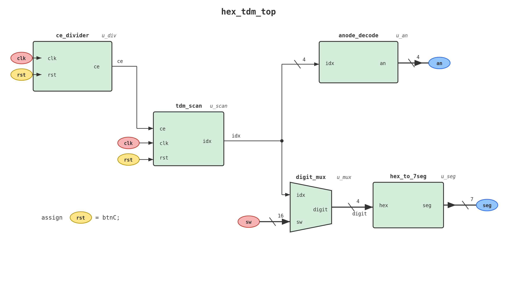

# Lab 7: Hex Display with Time-Division Multiplexing (TDM)

## Overview

In this lab, you will build a time-division multiplexed (TDM) 4-digit hex display for the Basys3 board. The Basys3 has four 7-segment digits that share a single segment bus -- only one digit can be driven at a time. By cycling through the digits fast enough (hundreds of Hz), all four appear to be lit simultaneously.

The lab is split into two parts that use **this one repository**:

| Part | What you do | Where | Tools |
|------|-------------|-------|-------|
| **Part A** | Anode decoder, digit mux, and the anode decoder testbench | On your own | GitHub only -- no Vivado, no board |
| **Part B** | Top-level integration, simulation, and hardware demo | In lab | Vivado + Basys3 |

The finished system integrates five modules:
1. **CE Divider** (clock enable divider) -- divides the 100 MHz clock and generates a one-cycle clock-enable (CE) pulse every `DIV_VAL` clocks
2. **TDM Scan** -- 2-bit counter that selects which digit is active (0..3)
3. **Anode Decoder** -- maps the scan index to active-low one-hot anode outputs
4. **Digit Mux** -- selects the correct 4-bit nibble from the 16 switches
5. **Hex-to-7seg Decoder** -- converts each nibble to active-low segment patterns

The CE divider, scan controller, and hex-to-7seg decoder are provided complete.

**Design Hierarchy:**
```
hex_tdm_top (top-level wrapper)        PART B: you complete
├── ce_divide    - Clock enable divider (CE every DIV_VAL clocks)
├── tdm_scan     - 2-bit rotating digit index
├── anode_decode - Active-low anode selection       PART A: you implement
├── digit_mux    - Nibble selector from switches    PART A: you complete
└── hex_to_7seg  - Hex-to-segment decoder
```

**RTL Diagram:**



---

## Part A: Decoder and Mux (GitHub only)

Part A is two small combinational modules and one testbench. Both modules use the `always @(*)` + `case` pattern from Lab 6. You do not need Vivado: GitHub Actions simulates your code every time you commit.

### Your Tasks

1. **Implement `rtl/anode_decode.v`** -- Write the combinational case statement mapping `idx` to active-low anode patterns
2. **Complete `rtl/digit_mux.v`** -- Add the two missing case entries for idx=2 and idx=3
3. **Complete `tb/anode_decode_tb.v`** -- Instantiate the DUT and add the three remaining test vectors

### Steps

- [ ] Accept the GitHub invitation for `Fa26DigitalLab/lab7-<your-github-username>`
- [ ] Open `rtl/anode_decode.v` and implement the case statement from the truth table in the file header
- [ ] Hint: Model it after `rtl/hex_to_7seg.v` -- same pattern, different mapping
- [ ] Open `rtl/digit_mux.v` and add the two missing cases, following the two provided cases
- [ ] Open `tb/anode_decode_tb.v` and complete TODO #1 (instantiate `anode_decode` as `UUT`) and TODO #2 (test vectors for idx = 1, 2, 3)
- [ ] Commit and push, then open the **Actions** tab

You can edit the three files right on github.com (open the file, click the pencil icon, then **Commit changes**) or clone the repo and use VS Code and GitHub Desktop as usual.

### Part A is done when

`Test anode_decode` and `Test digit_mux` are green on the **Actions** tab.

> **The overall run will still show a red X after Part A.** That is expected: `Test hex_tdm_top` cannot pass until you wire the top level in Part B. Click the run and look at the individual jobs.

---

## Part B: TDM Display (in lab)

### Pre-Lab / Background

1. Review sequential logic basics (D flip-flops, synchronous reset, enable)
2. Review Verilog parameters and how to override them at instantiation
3. Read the background notes in `background.md` for clock division and TDM theory

### Your Task

**Complete `rtl/hex_tdm_top.v`** -- Declare wires (TODO #1) and instantiate all five submodules (TODOs #2-#6)

### Step 1: Vivado Project Setup
- [ ] Clone your `lab7-<your-github-username>` repo into your Box Drive folder with GitHub Desktop (or pull, if you already cloned it for Part A)
- [ ] Launch Vivado and create a new project
- [ ] Set the project location *outside* of your repo folder
- [ ] Add all `.v` files from `rtl/` as **design sources**
- [ ] Add testbench files from `tb/` as **simulation sources**
- [ ] Add the constraint file from `constraints/`
- [ ] Select the Basys3 board as target

### Step 2: Top-Level Integration
- [ ] Open `rtl/hex_tdm_top.v` and work through TODOs #1-#6
- [ ] Use the RTL diagram (`Assets/rtl_hex_tdm_top.png`) as your guide
- [ ] TODO #1: Declare the internal wires
- [ ] TODOs #2-#6: Instantiate each submodule with correct port connections

### Step 3: Simulation
- [ ] Set `hex_tdm_top_tb` as the simulation top module
- [ ] Run behavioral simulation and observe `an` cycling through one-hot patterns
- [ ] Verify `seg` outputs match expected patterns for each digit
- [ ] The testbench uses a small `DIV_VAL` (10) so that scanning is visible in simulation

### Step 4: Hardware Implementation
- [ ] Set `hex_tdm_top` as the top module for synthesis (default `DIV_VAL=250_000` gives a 400 Hz CE)
- [ ] Synthesize, implement, and generate bitstream
- [ ] Program the Basys3 and verify a stable, flicker-free 4-digit display

---

## Checking Your Work

When you push your code, GitHub Actions will automatically compile and test your modules:

| CI Job | Part | What It Tests | Files Compiled |
|--------|------|--------------|----------------|
| `Test anode_decode` | A | Your anode decoder, using your testbench | `anode_decode.v` + `anode_decode_tb.v` |
| `Test digit_mux` | A | Your digit mux | `digit_mux.v` + `digit_mux_tb.v` |
| `Test ce_divide` | -- | Provided CE divider (not graded, should always pass) | `ce_divide.v` + `ce_divide_tb.v` |
| `Test hex_tdm_top` | B | Full TDM display system | All 6 RTL files + `hex_tdm_top_tb.v` |

`Test anode_decode` also requires your testbench to check **all four `idx` values** against the truth-table patterns, so a testbench with only the provided idx=0 vector fails.

---

## File Structure

```
├── rtl/
│   ├── ce_divide.v          # Clock enable divider (provided)
│   ├── tdm_scan.v           # 2-bit scan controller (provided)
│   ├── anode_decode.v       # Active-low anode decoder (Part A: you implement)
│   ├── digit_mux.v          # Nibble mux (Part A: you complete)
│   ├── hex_tdm_top.v        # Top-level integration (Part B: you complete)
│   └── hex_to_7seg.v        # Hex-to-segment decoder (provided)
├── tb/
│   ├── ce_divide_tb.v       # CE divider testbench (provided)
│   ├── anode_decode_tb.v    # Anode decoder testbench (Part A: you complete, CI-tested)
│   ├── digit_mux_tb.v       # Digit mux testbench (provided, CI-tested)
│   └── hex_tdm_top_tb.v     # Integration testbench (provided, CI-tested)
├── constraints/
│   └── basys3.xdc           # Pin assignments for Basys3
└── .github/workflows/
    └── test.yml              # CI - auto-tests on push
```

---

## Hardware Interface

### Inputs
| Port | Pins | Description |
|------|------|-------------|
| `clk` | W5 | 100 MHz system clock |
| `btnC` | U18 | Center button = synchronous reset (active-high) |
| `sw[15:0]` | V17..R2 | 16 slide switches = four hex digits |

### Outputs
| Port | Pins | Description |
|------|------|-------------|
| `seg[6:0]` | W7..U7 | 7-segment cathodes {g,f,e,d,c,b,a} (active-low) |
| `an[3:0]` | U2..W4 | 7-segment anodes (active-low, one-hot) |

### Switch-to-Digit Mapping
| Switches | Digit Position | Anode |
|----------|---------------|-------|
| `sw[3:0]` | Rightmost (digit 0) | `an[0]` |
| `sw[7:4]` | Second from right (digit 1) | `an[1]` |
| `sw[11:8]` | Third from right (digit 2) | `an[2]` |
| `sw[15:12]` | Leftmost (digit 3) | `an[3]` |

---

## What to Submit

**Part A:** Push your code. `Test anode_decode` and `Test digit_mux` must be green.

**Part B:** Push your code so that `Test hex_tdm_top` is green, then demo your working Basys3 to the instructor or TA. Set different switch patterns and show a stable, flicker-free 4-digit hex display.

There is nothing to upload to Canvas. See *Lab 7 Part A* and *Lab 7 Part B* in Canvas for points and due dates.

---

## Common Issues and Troubleshooting

### Part A (CI)
- **`Test anode_decode` shows `an = zzzz`**: `UUT` is not instantiated in `tb/anode_decode_tb.v` (TODO #1)
- **TEST PASSED but the job is still red**: your testbench does not check all four `idx` values (TODO #2)
- **`Test digit_mux` fails for idx 2 or 3**: missing or swapped case entries in `digit_mux.v`

### Synthesis Errors
- **Net is not defined (`ce`, `idx`, `digit`)**: Make sure you declared all internal wires (TODO #1)
- **Port mismatch**: Verify port names match exactly between your instantiations and the module definitions
- **Undeclared module**: Ensure all six `.v` files from `rtl/` are added to the Vivado project

### Simulation Issues
- **Blank display (all segments off)**: Check that `anode_decode` outputs active-low (0 = ON)
- **Wrong digit on wrong position**: Verify nibble order in `digit_mux` matches anode order in `anode_decode`
- **No scanning (stuck on one digit)**: Check that `ce` is connected to `tdm_scan` in the top-level

### Hardware Issues
- **Flickering display**: The scan rate is too slow. Use a smaller `DIV_VAL` to scan faster
- **Digits appear but in wrong order**: Check switch-to-nibble and index-to-anode mapping
- **All segments on/off**: Verify active-low polarity in constraint file matches your design
